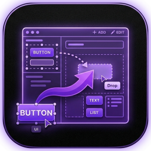
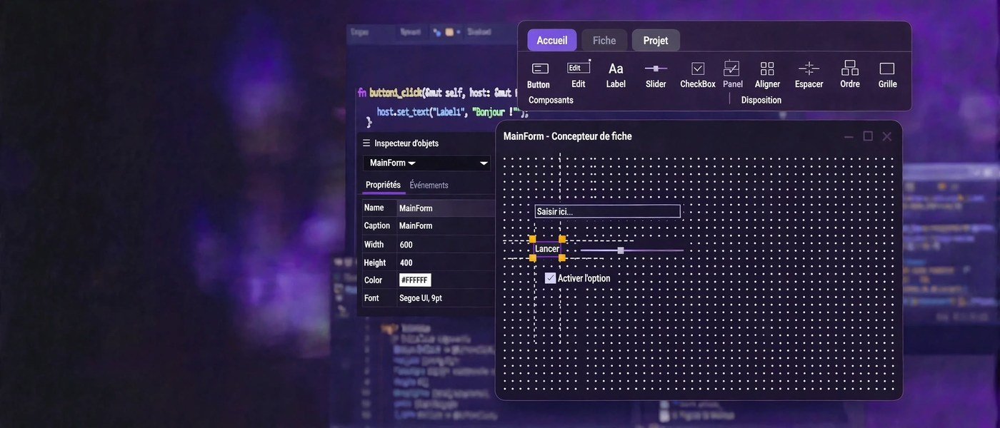

  

<h1 align="center">UIdeCraft</h1>

  <b>Concepteur d'interfaces egui façon Delphi : on dessine la fiche, le code Rust suit.</b> 
  <i>Delphi-style WYSIWYG form designer for egui: draw the form, the Rust code follows.</i>

  
  
  

  

## Présentation / Overview

UIdeCraft reprend l'esprit de Delphi pour les interfaces **egui** :

- un **concepteur** de fiches par glisser-déposer, avec palette de composants
- un **inspecteur** de propriétés
- un **aperçu en direct**
- un fichier de fiche (.form) et du code généré qui **préserve le code écrit à la main**

Il sert à concevoir les interfaces des logiciels FeBe (MakerCraft, Isel Jog, c2d_to_nc...).

*UIdeCraft brings the Delphi workflow to egui: drag-and-drop form designer, property inspector, live preview, and generated code that keeps your hand-written code intact.*

## Statut / Status

En développement, pas encore diffusé : le code sera publié ici avec la première version utilisable.

*In development, not yet released: the source code will be published here with the first usable version.*

## Liens / Links

- Site : [uidecraft.fe-be.fr](http://uidecraft.fe-be.fr)
- Contact : uidecraft@fe-be.fr
- Soutien / Support : [Patreon FeBeSoft](https://www.patreon.com/c/FeBeSoft) (le logiciel est et restera gratuit / the software is and will remain free)

Licence prévue / Planned license : GPL-3.0

## Remerciements / Credits

Merci à tous ceux dont le travail a rendu UIdeCraft possible / Thanks to everyone whose work made UIdeCraft possible:

- Emil Ernerfeldt et les contributeurs d'[egui / eframe](https://github.com/emilk/egui)
- les auteurs d'egui-rad-builder, première idée de concepteur visuel pour egui
- Borland et l'équipe de Delphi 7, dont l'environnement reste un modèle
- l'équipe de [Lazarus](https://www.lazarus-ide.org), qui fait vivre cet esprit en logiciel libre
- les équipes de Rust, serde, RON, toml et rfd

---

Un projet <a href="https://fe-be.fr">FeBe</a> - logiciels libres pour makers

